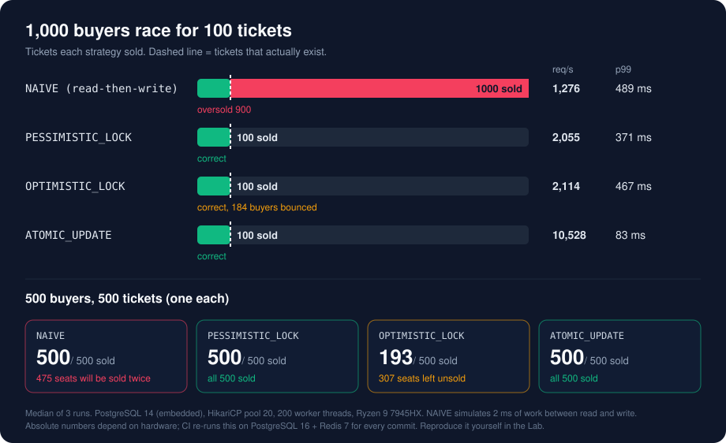
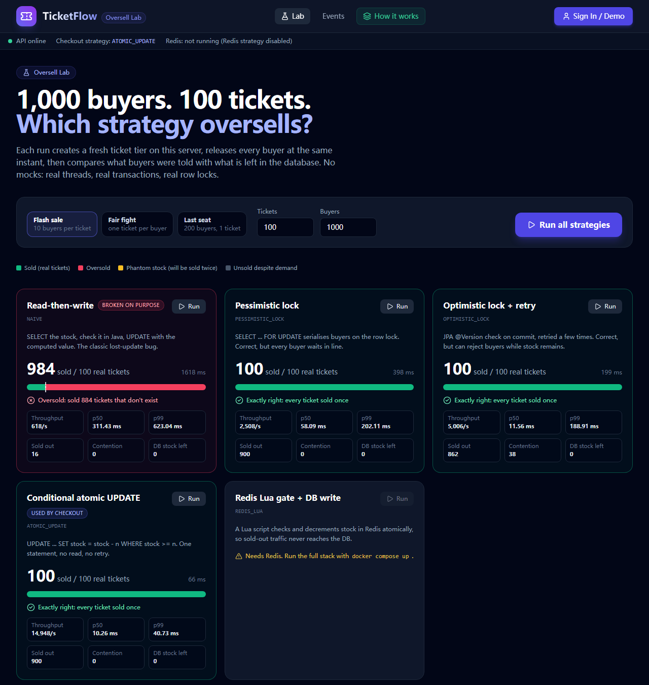

# TicketFlow · Oversell Lab

**1,000 buyers. 100 tickets. Which inventory strategy oversells?**

TicketFlow is a working flash-sale ticketing system (Spring Boot 3, Java 21, PostgreSQL, Redis, React) built around one question every booking system has to answer. It ships with the **Oversell Lab**: race any number of buyers against five interchangeable inventory strategies on a real database, and see who oversells, who leaves seats unsold, and who is fast.

[](https://github.com/cs50-citizen/ticketflow/actions/workflows/ci.yml)
[](LICENSE)


[中文说明](README.zh-CN.md) · [Strategy deep dive](docs/strategies.md) · [Bugs we found and fixed](docs/pitfalls.md)



## Try it in one command

```bash
git clone https://github.com/cs50-citizen/ticketflow.git
cd ticketflow
docker compose up --build
```

Open **http://localhost:3000** and press **Run all strategies**.

| Service | URL |
|---|---|
| App + Oversell Lab | http://localhost:3000 |
| Swagger UI | http://localhost:3000/swagger-ui.html |
| Grafana (admin / admin) | http://localhost:3001 |
| Prometheus | http://localhost:9090 |

<details>
<summary><b>No Docker?</b> Run it with an in-memory database instead</summary>

Needs Java 21 and Node 22. Uses H2, so everything except the Redis strategy works.

```bash
cd backend && ./mvnw spring-boot:run      # http://localhost:8080
cd frontend && npm install && npm run dev  # http://localhost:5173
```
</details>

Shareable scenarios: `http://localhost:3000/?stock=1&buyers=200&run=1` opens the Lab and starts racing 200 buyers for one last seat.



## The five strategies

All five implement one interface, [`InventoryStrategy`](backend/src/main/java/com/ticketflow/inventory/InventoryStrategy.java). Checkout uses whichever you configure (`INVENTORY_STRATEGY`); the Lab can run any of them.

| Strategy | How it reserves a ticket | Oversells? | The catch |
|---|---|:---:|---|
| `NAIVE` | `SELECT` stock, check in Java, `UPDATE` with the computed value | **Yes** | Lost updates. Included on purpose so you can watch it break |
| `PESSIMISTIC_LOCK` | `SELECT … FOR UPDATE`, then decrement | No | Buyers queue on one row lock, each holding a DB connection while waiting |
| `OPTIMISTIC_LOCK` | JPA `@Version` check on commit, up to 3 retries | No | Under a stampede most attempts collide: buyers get turned away while seats are still free |
| `ATOMIC_UPDATE` *(default)* | `UPDATE … SET stock = stock - n WHERE stock >= n` | No | Still one hot row in the database; nothing filters traffic before it |
| `REDIS_LUA` | Lua script checks + decrements in Redis, winners then do the atomic `UPDATE` | No | Needs Redis; cache drift is compensated (it can cause false "sold out", never oversell) |

Full write-ups with the SQL, failure modes and when to pick each: **[docs/strategies.md](docs/strategies.md)**.

## Results

Median of three runs on one laptop (Ryzen 9 7945HX, PostgreSQL 14 embedded, HikariCP pool of 20, 200 worker threads). Absolute numbers depend on your hardware, so compare the strategies with each other, not with other machines. CI re-runs the same race on **PostgreSQL 16 + Redis 7** for every commit and posts the table in the job summary.

**Flash sale: 1,000 buyers, 100 tickets**

| Strategy | Sold | Oversold | Throughput | p99 latency |
|---|---:|---:|---:|---:|
| `NAIVE` | 1,000 | **900** ❌ | 1,276 req/s | 489 ms |
| `PESSIMISTIC_LOCK` | 100 | 0 | 2,055 req/s | 371 ms |
| `OPTIMISTIC_LOCK` | 100 | 0 (184 buyers bounced by contention) | 2,114 req/s | 467 ms |
| `ATOMIC_UPDATE` | 100 | 0 | **10,528 req/s** | **83 ms** |

**Fair fight: 500 buyers, 500 tickets (one each)**

| Strategy | Sold | What went wrong |
|---|---:|---|
| `NAIVE` | 500 | The DB still shows **475 free seats** that were already sold: they will be sold twice |
| `PESSIMISTIC_LOCK` | 500 | Nothing |
| `OPTIMISTIC_LOCK` | 193 | **307 seats left unsold** although every buyer wanted one |
| `ATOMIC_UPDATE` | 500 | Nothing |

What surprised us:

- **NAIVE can oversell even when "sold" looks right.** In the fair fight it sold exactly 500, so a quick check passes. The bug only shows in the stock column, which the Lab reports as *phantom stock*.
- **Optimistic locking is correct, and it still costs sales.** It never oversold, but with many buyers on one row it rejected 60% of them while seats remained. That is fine for rarely-contended rows and bad for a flash sale.
- **The simplest correct answer was also the fastest.** One conditional `UPDATE` beat the explicit lock by 2–5× (5× in the flash sale), because nobody holds a lock across a round trip between Java and the database.

## More than a benchmark

The booking flow around the strategies is built the way you'd want it in production:

- **Reserve → hold → pay / cancel / expire.** Orders hold seats for 10 minutes. Every state change is a compare-and-set `UPDATE … WHERE status = 'PENDING'`, so a payment racing the expiry sweeper cannot both confirm the order *and* give its seat back. This was a real bug here, [see the write-up](docs/pitfalls.md#1-payment-racing-the-expiry-sweeper-sold-the-same-seat-twice).
- **Compensation.** Stock is reserved in its own short transaction; if saving the order fails, the reservation is released.
- **Idempotent retries.** `POST` requests accept an `Idempotency-Key`. A retry replays the first response (`Idempotent-Replayed: true`), a key reused with a different body gets `422`, keys are scoped per user, and a `5xx` frees the key. Backed by Redis in production and in-memory in dev.
- **Multi-instance safe.** No in-process locks; the expiry sweeper needs no leader election because of the compare-and-set.
- **Observability.** Every response carries a `traceId` (also in logs via MDC). The Prometheus metrics include `ticketflow_booking_reservations_total{strategy,result}`, and a provisioned Grafana dashboard shows reservations, latency, errors and connection-pool pressure.
- **Security basics.** Stateless JWT, BCrypt, the secret is required in prod (no default), JSON 401/403 responses, actuator locked down, CORS allow-list, no stack traces in error responses.
- **Deployable.** Multi-stage Docker images, `docker compose` for the full stack, and Terraform for AWS (VPC, ECS Fargate, RDS PostgreSQL, ElastiCache Redis, ALB, S3 + CloudFront, secrets in SSM).

## Tests

```bash
cd backend && ./mvnw verify
```

- `InventoryStrategyConcurrencyTest`: 200 buyers, 20 tickets, every strategy. Asserts the safe ones never oversell and that `NAIVE` does.
- `PostgresStrategyComparisonTest`: the same race on real PostgreSQL 16 + Redis 7 via Testcontainers (skipped without Docker, always run in CI).
- `BookingServiceTest`: concurrent booking, cancel, expiry, ownership, and the pay-vs-expiry race as a regression test.
- `IdempotencyTest`: replay, payload mismatch, per-user scoping.

Load-test the real checkout API with [k6](https://k6.io): `k6 run k6/stress_test.js` (see the header of the script for options).

## API

| Method | Path | Auth | |
|---|---|:---:|---|
| `GET` | `/api/v1/lab/strategies` | – | Strategies, availability, which one checkout uses |
| `POST` | `/api/v1/lab/runs` | – | `{"strategy":"NAIVE","stock":100,"buyers":1000}` |
| `GET` | `/api/v1/events` | – | Events with live availability |
| `POST` | `/api/v1/auth/login` | – | Demo: `demo@ticketflow.test` / `password123` |
| `POST` | `/api/v1/orders` | JWT | Reserve; send `Idempotency-Key` |
| `POST` | `/api/v1/orders/pay` | JWT | Mock payment |
| `POST` | `/api/v1/orders/{orderNumber}/cancel` | JWT | Release a held order |
| `GET` | `/api/v1/orders` | JWT | My orders |

Interactive docs at `/swagger-ui.html`.

## Project layout

```
backend/src/main/java/com/ticketflow/
  inventory/       InventoryStrategy + the five implementations  ← start here
  lab/             Oversell Lab: runs a strategy against a throwaway tier
  booking/         Orders: reserve, pay, cancel, expiry sweeper
  idempotency/     Idempotency-Key filter + Redis / in-memory stores
  auth/, event/    Users + JWT, events + ticket tiers
  config/          Security, tracing, OpenAPI, demo data
frontend/src/pages/LabPage.tsx      The Lab UI
infra/terraform/                    AWS deployment
infra/grafana/                      Provisioned dashboard
k6/stress_test.js                   End-to-end load test
docs/                               Strategy deep dive, pitfalls
```

## Contributing

The easiest way in is to **add a strategy**: implement `InventoryStrategy`, add a value to `InventoryStrategyType`, and the Lab, tests and UI pick it up. Ideas that would make great PRs:

- Single-writer queue (Kafka / Redis Streams) that serialises orders per tier
- Sharded stock counters (split one hot row into N rows)
- PostgreSQL advisory locks
- `SELECT … FOR UPDATE SKIP LOCKED` for assigned seating (pick any free seat)

See [CONTRIBUTING.md](CONTRIBUTING.md). Ran the Lab on interesting hardware or a managed database? Post your numbers in [Discussions](https://github.com/cs50-citizen/ticketflow/discussions).

## License

[MIT](LICENSE). All events and venues in the demo data are fictional; payments are mocked.
