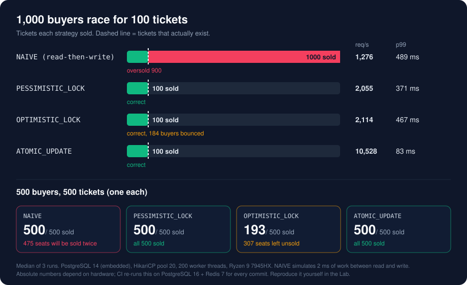

# TicketFlow · 超卖实验室

**1000 人抢 100 张票，哪种库存扣减方案会超卖？**

TicketFlow 是一个能跑起来的秒杀/抢票系统，技术栈是 Spring Boot 3、Java 21、PostgreSQL、Redis 和 React。它附带一个 **超卖实验室（Oversell Lab）**：在真实数据库上让任意数量的买家同时抢票，对比 5 种可插拔的库存扣减策略，看哪种会超卖、哪种会卖不完、哪种最快。

[](https://github.com/yuhang-deng-cs/ticketflow/actions/workflows/ci.yml)
[](LICENSE)

[English](README.md) · [策略详解（英文）](docs/strategies.md) · [我们踩过的坑（英文）](docs/pitfalls.md)



## 一条命令跑起来

```bash
git clone https://github.com/yuhang-deng-cs/ticketflow.git
cd ticketflow
docker compose up --build
```

打开 **http://localhost:3000**，点 **Run all strategies**。

没有 Docker 也能跑（使用 H2 内存库，只有 Redis 策略不可用）：

```bash
cd backend && ./mvnw spring-boot:run      # http://localhost:8080
cd frontend && npm install && npm run dev  # http://localhost:5173
```

场景可以通过链接分享，例如 `http://localhost:3000/?stock=1&buyers=200&run=1`：200 人抢最后 1 张票，打开即开跑。

## 五种策略

五种策略都实现同一个接口 [`InventoryStrategy`](backend/src/main/java/com/ticketflow/inventory/InventoryStrategy.java)。下单流程使用哪一种由 `INVENTORY_STRATEGY` 配置决定，实验室可以运行任意一种。

| 策略 | 做法 | 会超卖吗 | 代价 |
|---|---|:---:|---|
| `NAIVE` | 先 `SELECT` 库存，在 Java 里判断，再 `UPDATE` 成计算出的值 | **会** | 丢失更新。故意保留，用来演示错误写法 |
| `PESSIMISTIC_LOCK` | `SELECT … FOR UPDATE` 后再扣减 | 不会 | 所有人排队等同一把行锁，等待期间还占着数据库连接 |
| `OPTIMISTIC_LOCK` | JPA `@Version` 版本号校验，冲突时最多重试 3 次 | 不会 | 热点行冲突严重：明明还有票，买家却因重试耗尽被拒 |
| `ATOMIC_UPDATE`（默认） | `UPDATE … SET stock = stock - n WHERE stock >= n` | 不会 | 所有请求仍然打到数据库的同一行上 |
| `REDIS_LUA` | Lua 脚本在 Redis 里原子地判断并扣减，抢到的人再执行数据库原子更新 | 不会 | 需要 Redis；缓存与数据库不一致时会自动补偿（最多误报售罄，不会超卖） |

## 实测结果

同一台笔记本上 3 次运行取中位数（Ryzen 9 7945HX，嵌入式 PostgreSQL 14，连接池 20，200 个工作线程）。绝对数值取决于硬件，请比较策略之间的相对差异。每次提交 CI 都会在 **PostgreSQL 16 + Redis 7** 上重跑并把结果写进 Job Summary。

**秒杀场景：1000 人抢 100 张**

| 策略 | 卖出 | 超卖 | 吞吐量 | p99 |
|---|---:|---:|---:|---:|
| `NAIVE` | 1000 | **900** ❌ | 1,276 req/s | 489 ms |
| `PESSIMISTIC_LOCK` | 100 | 0 | 2,055 req/s | 371 ms |
| `OPTIMISTIC_LOCK` | 100 | 0（184 人因冲突被拒） | 2,114 req/s | 467 ms |
| `ATOMIC_UPDATE` | 100 | 0 | **10,528 req/s** | **83 ms** |

**公平场景：500 人抢 500 张（人手一张）**

| 策略 | 卖出 | 问题 |
|---|---:|---|
| `NAIVE` | 500 | 数据库里还显示 **475 张余票**，其实早已卖出，之后会被卖第二次 |
| `PESSIMISTIC_LOCK` | 500 | 无 |
| `OPTIMISTIC_LOCK` | 193 | **307 张票没卖出去**，尽管每个买家都想要 |
| `ATOMIC_UPDATE` | 500 | 无 |

几个反直觉的发现：

- **"卖出数量正确"不代表没超卖。** 公平场景下 NAIVE 恰好卖出 500 张，简单的断言会通过，问题藏在库存里。实验室把这部分单独统计为 *phantom stock*（幽灵库存）。
- **乐观锁是正确的，但会损失销量。** 它从不超卖，但在热点行上拒绝了约 60% 的买家，而此时还有余票。
- **最简单的正确方案也是最快的。** 一条带条件的 `UPDATE` 比显式加锁快 2–5 倍，因为没有人跨网络往返持有锁。

## 不只是基准测试

- **预占 → 待支付 → 支付 / 取消 / 超时释放**：订单状态变更全部是 `UPDATE … WHERE status = 'PENDING'` 形式的 CAS。支付与超时清理任务同时发生时只有一方能成功，不会出现"已支付但座位又被放回"的情况。这是本项目真实修过的 bug，[详见这里](docs/pitfalls.md#1-payment-racing-the-expiry-sweeper-sold-the-same-seat-twice)。
- **补偿**：库存在独立的短事务里预扣，订单保存失败时自动归还。
- **幂等重试**：`Idempotency-Key` 重复时回放第一次的响应，Key 被用于不同请求体时返回 422，Key 按用户隔离，5xx 会释放 Key。
- **多实例安全**：没有进程内锁，超时清理任务依靠 CAS，不需要分布式锁或选主。
- **可观测性**：每个响应都带 `traceId`，Prometheus 指标 `ticketflow_booking_reservations_total{strategy,result}`，并预置 Grafana 看板。
- **可部署**：多阶段 Docker 镜像、docker compose 全栈、Terraform 部署 AWS（ECS Fargate、RDS、ElastiCache、ALB、CloudFront，密钥存放在 SSM）。

## 测试

```bash
cd backend && ./mvnw verify
```

包括：所有策略的并发正确性测试（NAIVE 必须超卖，其他策略不允许超卖）、基于 Testcontainers 的 PostgreSQL + Redis 对比测试、支付与超时竞态的回归测试，以及幂等性测试。

## 参与贡献

最简单的入门方式是 **新增一种策略**：实现 `InventoryStrategy`，在 `InventoryStrategyType` 里加一个枚举值，实验室、测试和界面会自动识别。欢迎的方向：

- 按票档串行处理的单写者队列（Kafka / Redis Streams）
- 分段库存（把一行热点拆成 N 行）
- PostgreSQL advisory lock
- `SELECT … FOR UPDATE SKIP LOCKED`（选座场景）

详见 [CONTRIBUTING.md](CONTRIBUTING.md)。如果你在别的硬件或云数据库上跑出了有意思的数据，欢迎发到 [Discussions](https://github.com/yuhang-deng-cs/ticketflow/discussions)。

## 许可证

[MIT](LICENSE)。演示数据中的活动和场馆均为虚构，支付为模拟。
